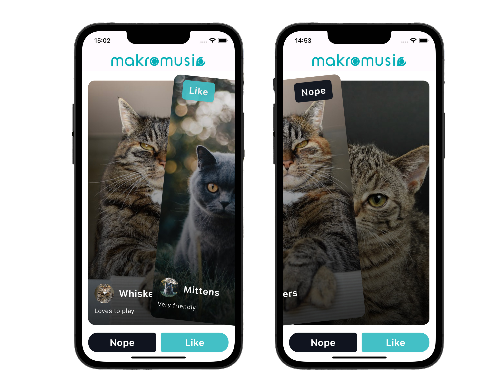

# MmSwipeable



MmSwipeable is a Flutter package that provides a widget for enabling swipe actions in both left and right directions.

## Features

- Allows users to swipe a child widget either to the left or right.
- Decides a swipe from where the card is heading: the release point is projected forward by the finger's velocity, so a quick short flick and a long slow drag both commit, and the direction follows the motion.
- Claims only horizontal drags, so a vertical scrollable inside the card keeps its gestures.
- Does not automatically dismiss the child widget upon swipe; instead, triggers callback functions to handle the swipe actions.
- Enables customization of swipe action confirmation conditions.
- Publishes the swipe progress (-1..1) through a controller, e.g. to fade in like/nope labels.
- Supports programmatically controlling swipe actions through a dedicated controller.

## Usage

Wrap the widget that you want to make swipeable with the `MmSwipeable` widget and provide the necessary callback functions to handle swipe actions:

```dart
final swipeableController = MmSwipeableController();

MmSwipeable(
  controller: swipeableController,
  // Fraction of the card's width the projected release point must pass.
  swipeThreshold: 0.35,
  // How far ahead the release velocity is projected.
  projectionTime: const Duration(milliseconds: 200),
  confirmSwipe: () {
    // Called once the swipe passed the threshold.
    // `true` commits, `false` springs back and calls the cancelled callback,
    // `null` springs back silently.
    if (!canSwipe) return false;
    return true;
  },
  onSwipedLeft: () {
    // Handle swipe left action.
  },
  onSwipedRight: () {
    // Handle swipe right action.
  },
  onSwipeLeftCancelled: () {
    // Handle swipe left cancellation.
  },
  onSwipeRightCancelled: () {
    // Handle swipe right cancellation.
  },
  child: Container(
    height: 600,
    color: Colors.blue,
  ),
)
```

Listen to the controller to follow the swipe while the card moves:

```dart
swipeableController.addListener(() {
  final progress = swipeableController.value.progress;
  // -1 is fully towards a left swipe, 1 fully towards a right swipe.
});
```

You can also use a `MmSwipeableController` to programmatically control the behavior of the swipeable widget:

```dart
// Programmatically trigger a swipe right action
swipeController.swipeRight();

// Programmatically trigger a swipe left action
swipeController.swipeLeft();
```

For more details and examples, check out the [example](example) directory.

## License

This project is licensed under the MIT License - see the [LICENSE](LICENSE) file for details.
